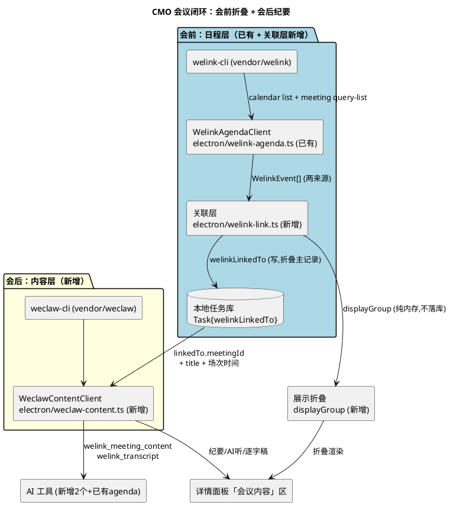

# CMO 会议闭环方案：会前折叠去重 + 会后纪要获取

2026-11-20 定稿。在现有「双来源日程同步」（welink-cli：邮箱日历 + WeLink 会议）之上，解决两个断点：

| 断点 | 表现 | 验收样本（2026-11-20 实测） |
|---|---|---|
| **会前重复** | 同一会议在日历和会议系统各落一条，用户看到两条 | 11-20「Data AI产品例会」：日历 1 条（【会议通知】Data AI产品例会，14:00-16:00）+ 会议系统 1 条（meetingId=217292947, meetingNo=96663039，同时段） |
| **会后断层** | 会开完了，点开日程看不到这场会讲了什么 | welink-cli 无纪要命令；纪要/AI听逐字稿在 weclaw-cli（实测 11-17 海思元数据平台周例会逐字稿 9812 字可取） |

目标：**会前一条干净的记录，点开能看会后讲了什么。**

---

## 一、已验证事实（全部实测，方案的地基）

### 1.1 跨源关联桥

- 日历详情 body 里有 `Meeting ID: 96663039`，`onlineMeetingUrl` 里有 `id=96663039` —— 两条通道都指向会议系统的 **meetingNo**（视频会议号）
- 会议系统事件自带 `meetingNo: 96663039` —— **跨源验证键相等**（11-20 Data AI 例会实测闭环）
- 注意：body 里的是 meetingNo，**不是** meetingId（会议主键 217292947 只存在于会议系统侧）

### 1.2 纪要体系的归属

- weclaw-cli 的纪要/ASR **挂在 WeLink 会议系统上**（`get-asr` 返回 `meeting_id` = welink-cli `query-list` 的 `meetingId`，同主键，11-17/11-19 两场实测命中）
- 与邮箱日历的关联是间接的：日历 → body Meeting ID → meetingNo → 会议系统 → meetingId → 纪要
- **meeting 来源的会议天然可直连纪要；calendar 来源必须先跨过 meetingNo 桥**

### 1.3 weclaw-cli 的坑（决定实现细节）

| # | 实测坑 | 应对 |
|---|---|---|
| 1 | **周期会议宽松路由**：206581097/098/099 三个相邻场次 ID 调 `get-asr` 返回**同一份** 11-17 逐字稿 | 读取后必须**场次校验**：返回 `start_time` 与目标场次时间比对，不一致返回 `wrong-session`，不静默顶替 |
| 2 | `search-content` 的 `--start-date/--end-date` 过滤不可靠（传了仍返回全量） | 客户端拿返回块内的场次时间（如 `2026-11-19 09:00-10:00`）做二次过滤 |
| 3 | `list-asr` 返回 `start_time/end_time/organizer` 全 null | 不依赖这些字段定位；用 subject + 时间窗检索，多候选返回让上层选 |
| 4 | 3008 服务（opencode）**只在 WeClaw 悬浮球展开后启动**，悬浮球合上服务即无 | `not-logged-in` 错误态细分：CLI 探测失败 ≠ WeClaw 未装 ≠ 悬浮球未展开；提示语「请展开员工助手悬浮球后重试」 |
| 5 | 输出双层 JSON（`{answer, status, tool_name}`，answer 内嵌 JSON/文本） | 两层解析；answer 是格式化文本（纪要）时保留原文，标 `format:'text'` |
| 6 | `get-asr` 无录制时返回明确 hint | 降级 `no-recording` 态，不重试 |
| 7 | 429 限流 | 复用请求队列 + 指数退避（1s/2s，最多 2 次） |

### 1.4 检索优先级（修订版）

**先 `search-content`（subject + 时间窗）拿块内精确时间做定位，再 `get-asr --meeting-id` 取全文。**

理由：search-content 返回块自带场次时间，比宽松路由的 get-asr 更可靠；meetingId 只作 get-asr 入参，不作场次定位依据。

---

## 二、总体架构



贯穿示例（11-20 Data AI 产品例会）：

```
会前同步:
  日历: itemId=AAMk...AAEA==, subject=【会议通知】Data AI产品例会, 14:00-16:00
  会议: meetingId=217292947, meetingNo=96663039, subject=Data AI产品例会, 14:00-16:00
  → 关联层预取日历详情 → body 提取 Meeting ID 96663039
  → meetingNo 相等 ∧ 账号一致 ∧ 时间全等 ∧ 候选唯一 → 关联成立
  → 主记录(日历).welinkLinkedTo = { provider:'meeting', id:'217292947', verifiedAt }
  → UI 折叠为一条「双来源」记录

会后取纪要:
  用户点「会议内容」→ WeclawContentClient
  → search-content(subject="Data AI产品例会", 时间窗=14:00-16:00)
  → 块内场次校验通过 → get-asr --meeting-id 217292947 / 纪要块直接用
  → 渲染纪要/AI听/逐字稿
```

---

## 三、关联层（`electron/welink-link.ts`，新增 ~150 行）

### 3.1 跨源关联判定（多条件合取 + 歧义即弃）

```
关联成立条件（全部满足）:
  meetingNo 相等
    日历侧: details body 提取 /Meeting\s*ID[:\s]*(\d+)/ + onlineMeetingUrl 的 id 参数（双通道互为校验）
    会议侧: WelinkEvent.meetingNo（已有字段）
  ∧ 账号一致（welinkAccount，已有字段）
  ∧ 场次时间一致（日历 start ≈ 会议 meetingStartTime，容差 ±5min）
  ∧ 候选唯一（同 meetingNo+时间窗内只命中一条会议记录；命中多条 → 歧义，不关联）

失效与重核:
  changeKey 变化（日历事件被更新）→ 丢弃旧关联，重新提取、重新核验
  body 提取到多个 Meeting ID → 歧义，不关联
  关联后会议事件被取消/时间漂移超出容差 → 解除关联
```

### 3.2 关联时机：同步时主动预取（不只靠用户点开详情）

fetch 发现同一天内「日历事件与会议事件时间重叠」时，对该日历事件批量预取详情提取 meetingNo：

- 每轮同步最多预取 **5 条**详情，仅对「今天~明天有重叠嫌疑」的事件
- CLI 调用限流串行（复用现有请求队列）
- 常规轮询（10 分钟）即可在会前完成关联，不依赖用户点击

### 3.3 主从与折叠规则

| 情形 | 主记录 | 副身份 | 完成传播 | 提醒认领 |
|---|---|---|---|---|
| **跨源关联成立** | **日历**（显示主体：标题/时间/详情/取消态/changeKey 信息最全） | meeting，经 `welinkLinkedTo` 保留 **meetingId**（纪要检索钥匙，日历侧永远没有） | ✅ 传播（组内任一完成 → 全组完成，各自保留 completedAt） | 写在主记录，组内视为同一目标，不双弹 |
| 日历内部重复（脏数据：不同 itemId 同标题同 start） | 无主从，`displayGroup` 纯折叠 | — | ❌ 不传播（治本是删脏数据） | 各管各的 |
| 仅日历有 | 日历 | — | — | — |
| 仅会议有（没进日历的会，如别人代建） | 会议 | — | — | — |
| 关联失效（changeKey 变/时间漂移） | 解除关联，回到双记录 | — | — | — |

**为什么日历为主**：详情丰富度（组织者/参会人/正文/入会链接只在日历侧）、真实取消标志（会议侧 `cancelled:false` 写死）、changeKey 支持失效重核。meeting 记录对折叠组的唯一实质贡献是 **meetingId**，经 linkedTo 借到主记录上。

**关键：`welinkLinkedTo` 是纪要链路的钥匙，不是显示装饰**：

| 纪要链路需要 | 折叠后位置 | 来源 |
|---|---|---|
| meetingId（weclaw 检索主键） | 主记录 `welinkLinkedTo.id` | 从 meeting 记录借来（日历只有 meetingNo，没有 meetingId） |
| 会议标题（search-content subject） | 主记录 `title` | 日历自带（检索时归一化去【会议通知】前缀） |
| 场次时间（时间窗 + 场次校验基准） | 主记录 `start/end` | 日历自带 |

### 3.4 持久化（数据链路改造）

```typescript
// Task 层新增（可选字段，JSON payload 存储零迁移）
welinkLinkedTo?: { provider: 'meeting'; id: string; verifiedAt: string } | null
// welink-sync.ts toTask(): existing?.welinkLinkedTo 像保留 external 一样结构化还原
// 失效：changeKey 变化 or 时间漂移出容差 → 置 null 并重核
// displayGroup 不落库——每轮 fetch 后由关联层现算，写进 Agenda 响应
```

同步事务内新增步骤：

1. 现有事件落库（不变）
2. 关联层计算：a) 已有 linkedTo 的重核验（changeKey/时间）；b) 疑似重复窗口预取详情提取 meetingNo；c) 四条件合取 → 写 linkedTo
3. displayGroup 纯内存计算（fetch 返回后算，写进 Agenda 响应，不进 Task）

同步链路四处配合改动：`toTask` 还原 linkedTo、事务内重核、提醒按组认领（`store.ts`）、按组计数。

---

## 四、内容层（`electron/weclaw-content.ts`，新增 ~260 行）

### 4.1 路径解析与运行（`electron/welink-cli.ts` 扩展 ~40 行）

```typescript
resolveWeclawCli() 查找顺序:
  1. vendor/weclaw/weclaw-cli.exe（开发 & extraResources 打包）
  2. C:\Program Files (x86)\UniAssistant\resources\bundled\opencode\weclaw-cli.exe（本机实测位置）
  3. C:\Program Files\WeClaw Desktop\...（旧路径写法兼容）
  4. PATH 兜底
runWeclaw(args, timeoutMs)  // 对齐 runWelink；常 30s，get-asr 全文放宽 60s
```

探测失败 → 明确提示「需安装员工助手（WeClaw）」，**不阻塞日程同步主链路**。

### 4.2 客户端接口

```typescript
export class WeclawContentClient {
  // 三级检索统一入口：纪要 → AI听 → 笔记，每级独立返回、独立标注，不静默替代
  async meetingContent(query: MeetingContentQuery): Promise<MeetingContent>
  async transcript(meetingId: number, expectedStart: string): Promise<TranscriptResult>
}

interface MeetingContentQuery {
  meetingId?: number   // 有可信 linkedTo 时优先
  subject: string      // 归一化标题（去【会议通知】前缀）
  start: string; end: string  // 场次时间窗（同时是场次校验基准）
}

interface MeetingContent {
  minutes?:    { source: '纪要', format: 'text'|'json', fetchedAt }
  transcript?: { source: 'AI听', segments: [{speaker, text}], format, fetchedAt }
  notes?:      { source: '笔记', docTitle, format, fetchedAt }
  candidates?: [{ meetingId, subject, time }]   // 多候选时返回，不自动取
  degraded?:   { reason }                        // 降级原因
}
```

### 4.3 关键实现规则（对应实测坑）

| 规则 | 实现 |
|---|---|
| **场次校验**（最重要） | search-content 块时间 / get-asr `start_time` 与 query 场次比对；不一致返回 `{ status:'wrong-session', actualTime }`，AI/UI 明示「取到的是 X 场」，绝不静默顶替 |
| **检索顺序** | 先 search-content（subject+时间窗）定位场次，再 get-asr --meeting-id 取全文；meetingId 不作场次定位依据 |
| **客户端时间过滤** | 服务端 --start-date/--end-date 不可靠，块内时间做二次过滤 |
| 双层 JSON | `JSON.parse(outer).answer` 再 parse；纪要是格式化文本时保留原文 `format:'text'` |
| 多候选 | 同主题多场（周期例会常态）返回 candidates，AI 层列出让用户选，禁止自动取第一条 |
| 限流 | 独立请求队列 + 429 指数退避（1s/2s，最多 2 次） |
| 缓存 | key=`{account}:{materialType}:{meetingId|docId}`；TTL 10min 仅性能策略；账号切换整体清空 |

### 4.4 错误分类（5 态）

| 状态 | 语义 | 重试策略 |
|---|---|---|
| `generating` | 服务端明确生成中 | UI 显示「生成中」；自动重试间隔 ≥2min |
| `no-recording` | 无录制记录（get-asr hint） | 不自动重试 |
| `no-permission` | 权限不足 | 不重试，提示原因 |
| `not-logged-in` | WeClaw 未启动/悬浮球未展开/凭证失效 | 提示「请展开员工助手悬浮球后重试」；恢复后自动可用 |
| `request-failed` | 网络/超时/未知 | 常规重试 1 次，失败如实报告 |

`request-failed` 永不缓存；`generating` 缓存 2min；其余按状态缓存，均允许手动穿透重试。

---

## 五、AI 工具（`modules/welink/ai-tools.ts` 扩展 ~60 行）

新增 2 个只读工具（无写操作，不需要 declare_write）：

```typescript
// 工具1：查会议内容（三级检索入口）
welink_meeting_content {
  taskId?: string          // CMO 日程 taskId——有则自动带出 linkedTo.meetingId / 标题 / 场次时间
  subject?: string         // 或直接给主题
  date?: 'YYYY-MM-DD'      // 单日定位
}
→ { minutes?, transcript?, notes?, candidates?, degraded?, wrongSession? }

// 工具2：读逐字稿全文
welink_transcript { meetingId: number, expectedStart: string }
→ { transcript, segments, itemCount } | { available: false, reason } | { status: 'wrong-session', actualTime }
```

systemPrompt 增补：

> 查询会议讲了什么用 `welink_meeting_content`（优先传 taskId 自动关联）。内容按 纪要 → AI听 → 笔记 三级**分别说明有无，不合并叙述**；`candidates` 非空时必须列出候选让用户选择，不要自动取第一条；`wrongSession` 表示取到的是另一场次，如实告知不要顶替；`available:false` 表示该会议无录制，如实告知不要重试。

---

## 六、UI（日程详情面板 ~130 行）

- **列表**：`displayGroup` 折叠渲染 +「双来源」徽章（与 `TaskSourceBadge` 并列不混用）；按组计数
- **详情面板**新增「会议内容」区块：
  - 会前（未到时间）：不显示（避免空态噪音）
  - 会后：显示 纪要 / AI听 / 笔记 三个懒加载区块，分别独立标注
  - 降级：`no-recording` 灰显「未开启 AI 听录制」；`not-logged-in` 提示「展开员工助手悬浮球」；`wrong-session` 明示实际取到的场次
  - 多候选：弹选择列表
- 折叠项展开可见两条原始记录（各自来源徽章、各自 external 保留）——审计能力不变

---

## 七、改动清单

| 文件 | 改动 | 量级 |
|---|---|---|
| `vendor/weclaw/weclaw-cli.exe` | 新增二进制（直接提交，与 welink-cli 先例一致，不走 LFS） | 9.6MB |
| `electron/welink-cli.ts` | `resolveWeclawCli()` + `runWeclaw()` | ~40 行 |
| **`electron/welink-link.ts`** | 关联层（四条件判定/歧义/重核/预取调度/displayGroup 计算） | ~150 行 |
| **`electron/weclaw-content.ts`** | 内容层（双层解析/三级检索/场次校验/5态错误/缓存） | ~260 行 |
| `electron/welink-agenda.ts` | `details()` 双通道提取 meetingNo（body + onlineMeetingUrl 互为校验） | ~15 行 |
| `electron/welink-sync.ts` | toTask 还原 linkedTo；事务内关联步骤；提醒按组认领 | ~80 行 |
| `store.ts`（todo） | 按组认领、按组计数 | ~40 行 |
| `shared/welink-agenda.ts` | 类型扩展（linkedTo/displayGroup/MeetingContent 族）+ `normalizeMeetingTitle()` | ~40 行 |
| `modules/welink/ai-tools.ts` | 2 个新工具 + systemPrompt | ~60 行 |
| `electron/ai-ipc.ts` / `desktop-island.ts` | WeclawContentClient 注入点 | ~20 行 |
| UI（列表折叠 + 详情内容区） | 折叠渲染/内容区/降级/候选选择 | ~130 行 |
| `package.json` | extraResources（vendor/weclaw → weclaw）+ version bump | 2 行 |
| `docs/welink-calendar-sync.md` | 更新设计边界（v2：折叠 + 会后内容） | 文档 |
| 测试 | 四条件关联/歧义/重核/场次校验/双层解析/5态/组语义；fixture 用脱敏虚构数据 | ~400 行 |

**合计约 ~1230 行新增 + 9.6MB 二进制**。存量代码只在注入点和同步事务动。

---

## 八、风险

| 风险 | 等级 | 缓解 |
|---|---|---|
| weclaw-cli 无版本稳定性承诺（WeClaw 内部组件） | 中 | vendor 锁版本；升级跑 fixture 回归；解析全容错。welink-cli 已开先例 |
| 3008 服务依赖悬浮球展开（实测） | 中 | `not-logged-in` 细分提示；不阻塞日程同步主链路 |
| 周期会议宽松路由取错场次 | 高→已缓解 | **场次校验强制**（4.3 首条）；wrong-session 明示 |
| 预取详情增加 CLI 调用量 | 低 | 每轮 ≤5 条、仅重叠嫌疑事件、串行限流 |
| body 模板变化致 meetingNo 提取失败 | 低 | 双通道提取（body + URL 参数）；失败只影响覆盖率，回退双记录现状 |
| 关联误判（同 meetingNo 多场次） | 低 | 时间全等 + 候选唯一双保险；歧义即弃，维持双记录 |

---

## 九、实施顺序（每步独立可验证、可回退）

```
P1  vendor 二进制 + resolveWeclawCli + runWeclaw + extraResources
    → 验证: 单测 + 本机 whoami 冒烟（悬浮球展开状态）
P2  weclaw-content.ts 内容层（双层解析/三级检索/场次校验/5态/缓存）
    → 验证: fixture 测试（用实测结构做样例，脱敏不落真实正文）
           + 本机取一场有录制的逐字稿（11-17 元数据例会样本）
P3  welink-link.ts 关联层（meetingNo 双通道提取 + 四条件判定 + linkedTo）
    + welink-agenda/sync/store 配合改动
    → 验证: 11-20 Data AI 例会应折叠为一条；AI 问"今天有什么会"看到一条
P4  AI 工具 ×2 + systemPrompt + 注入
    → 验证: AI 会话问"上周元数据例会讲了什么"端到端取到纪要
P5  UI：列表折叠 +「双来源」徽章 + 详情「会议内容」区 + 降级态/候选选择
    → 验证: 点开已结束日程看纪要；周期会议取错场次时明示
P6  打包验证（extraResources 进安装包）
    → 验证: 装到无 WeClaw 机器看降级提示；悬浮球未展开时的引导
```

P1-P2 纯后端无 UI 依赖；P3 是折叠与纪要两条线的交汇点（linkedTo 既是显示折叠的依据也是纪要钥匙）；P4 起端到端打通。

---

## 十、验收清单（对齐验收样本）

| 验收项 | 预期 |
|---|---|
| 11-20 Data AI 例会（跨源重复） | 折叠为 1 条「双来源」记录；点开详情有组织者/参会人（日历侧）；点「会议内容」能取到纪要/AI听 |
| 周期会议取纪要（如元数据周例会） | 场次校验生效：取到别场时明示「实际取到的是 X 场」，不静默顶替 |
| 纯日历日程（非会议） | linkedTo 为空；「会议内容」区显示「该会议无会议系统记录」 |
| WeClaw 悬浮球未展开 | 提示「请展开员工助手悬浮球后重试」；日程同步不受影响 |
| 未装 WeClaw 的机器 | 内容层整体降级提示；日程同步、折叠去重完全不受影响 |
| 提醒 | 折叠组只弹一次；未折叠的双记录各自提醒（现状不变） |
| 完成 | 跨源折叠组传播；日历内部脏数据折叠不传播 |
